# 🛰️ AgriPulse AI: Autonomous Climate Satellite, ML Yield Prediction, Parametric Insurance & Multi-Chain USDC Quant Agent

[](LICENSE)
[](AGENTS.md)
[](AGENTS.md)

> **Autonomous Full-Stack AI Agent & DePIN/DeFi Substrate for Global Climate Risk Hedging & Catastrophe Settlement**

---

## 🌍 Overview

**AgriPulse AI** is an enterprise-grade autonomous AI financial agent operating at the nexus of **Global Climate Satellite Telemetry $\rightarrow$ Machine Learning Crop Yield Prediction $\rightarrow$ CBOT Commodity Futures Quant Hedging $\rightarrow$ Smart Contract Parametric Insurance & Multi-Chain USDC Billing**.

It eliminates the traditional 3–6 month insurance adjustment delays and official USDA WASDE report information asymmetries by executing real-time Byzantine fault-tolerant climate data ingestion and instant on-chain zero-claim payouts.

---

## 🏛️ System Architecture

```mermaid
flowchart TB
    subgraph DataIngestion ["1. Global Weather & Satellite Ingestion Layer"]
        NOAA["NOAA CPC / GFS (Temp Anomaly, Rainfall)"]
        ECMWF["ECMWF ERA5 (VPD Deficit, Pressure)"]
        SMAP["NASA SMAP (0~100cm Root-Zone Soil Moisture VWC %)"]
        ENSO["ENSO Index (ONI, SOI El Niño/La Niña Index)"]
        NDVI["MODIS / Sentinel (Vegetation Health Index VHI)"]
    end

    subgraph MLEngine ["2. Climate Shock & Yield Engine (LightGBM/XGBoost Ensemble)"]
        EDD["Extreme Degree Days (EDD > 30°C Stress)"]
        SPEI["Standardized Precipitation Evapotranspiration Index (SPEI)"]
        YieldModel["Physics-ML Hybrid Model (Yield Anomaly %)"]
        MonteCarlo["1,000-Path Monte Carlo Tail Risk & VaR 95/99%"]
    end

    subgraph ExecutionLayer ["3. Dual Monetization & Settlement Substrate"]
        subgraph ModuleA ["Module A: CBOT Commodity Quant Trading"]
            AlphaGap["WASDE vs ML Forecast Alpha Gap"]
            PriceImpact["Stock-to-Use Elasticity Model"]
            PerpHedge["CBOT / DEX Futures Dynamic Delta Hedging"]
        end
        subgraph ModuleB ["Module B: Parametric Insurance & Cat-Bond Vault (v2.0)"]
            EIP712["EIP-712 Structured Oracle Signatures (ECDSA.recover)"]
            ERC4626["Senior / Junior Tranche Cat-Bond Vault (ERC-4626)"]
            ZeroClaim["Automated Zero-Claim Parametric Settlement"]
            EUDR["EUDR Satellite Geofence Forest Audit (20% ESG Rebate)"]
        end
        subgraph SecurityGate ["4. Autonomous Multi-Tier Security Gate v2.0"]
            BFT["Gate 0: 3-Node BFT Satellite Consensus"]
            Sandbox["Gate 1/2: Pre-Execution EVM Sandbox Simulation"]
            AntiMEV["Gate 3: Private Flashbots RPC & MEV-Blocker"]
            MultiSig["Gate 4: Gnosis Safe 3/5 Multi-Sig & Timelock"]
        end
    end

    subgraph MultiChainBilling ["5. Multi-Chain Native USDC Billing Gateway"]
        ArbitrumUSDC["Arbitrum One Native USDC (EIP-712 / EIP-3009)"]
        SolanaUSDC["Solana Mainnet SPL-USDC (Solana Pay QR)"]
        TreasurySafe["Sovereign Treasury Vaults & Dynamic Licensing"]
    end

    subgraph MissionControl ["6. Real-Time Mission Control Dashboard (Vite + React)"]
        GeoMap["Interactive Global Agricultural Basin Map"]
        YieldViz["Yield Anomaly Density & Tail Risk Curves"]
        QuantTerm["Live CBOT Quant Signals & Order Book"]
        SecurityHub["Enterprise Multi-Tier Security Status Hub"]
        BillingDrawer["Onchain USDC Subscription & License Manager"]
    end

    DataIngestion --> MLEngine
    MLEngine --> ModuleA & ModuleB
    ModuleA & ModuleB --> SecurityGate
    SecurityGate --> MultiChainBilling
    MultiChainBilling --> MissionControl
```



---

## ⚡ Core Pillars & Capabilities

### 1. Multi-Satellite Byzantine Consensus (BFT Oracle)
* Ingests real-time feeds from **NASA SMAP**, **ECMWF ERA5**, and **NOAA CPC**.
* Rejects spoofed or anomalous regional telemetry through a decentralized 3-node Byzantine Fault Tolerance algorithm before oracle commitment.

### 2. Dual Monetization Engine
* **CBOT Quant Alpha:** Capitalizes on the 2–3 week information latency of monthly USDA WASDE crop reports by dynamically taking long/short positions on CBOT Corn (`ZC`), Soybeans (`ZS`), and Wheat (`ZW`).
* **Parametric Smart Insurance:** Zero-claim automatic payout triggered when $\ge 2$ multi-index catastrophe thresholds are met (Soil Moisture $\le 20\%$, Consecutive Dry Days $\ge 21$, SPEI $\le -1.80$, EDD $\ge 35^\circ\text{C-days}$).

### 3. Enterprise Multi-Tier Security Gate v2.0
* **Pre-Execution Sandbox Simulation:** Simulates transactions in a forked EVM sandbox to detect infinite token approvals, reentrancy vulnerabilities, and balance drains.
* **Anti-MEV Shielding:** Routes transactions through Flashbots Builder RPCs to completely prevent sandwich attacks and front-running.
* **Canary Circuit Breaker:** Automatically freezes autonomous withdrawals if daily spend limits or drawdowns exceed protocol thresholds.

### 4. Multi-Chain Native USDC Billing Engine
* Seamless institutional B2B subscription and API micro-toll payments via **Circle Native USDC (6 decimals)** on both **Arbitrum One** and **Solana Mainnet**.
* Compliant with **EIP-712 Typed Data** and the **Solana Pay** protocol with instant automated license key (`AGRI-XXXX-ACTIVE`) issuance.

---

## 🚀 Quickstart

### 1. Run Unified Server (Backend + Frontend)
```bash
# Clone the repository
git clone https://github.com/your-username/climate-insurance-agent.git
cd climate-insurance-agent

# One-click start (Windows)
start.bat

# Or run directly via Python
python run.py
```
> Mission Control Dashboard will automatically launch at **`http://localhost:8500`**.

### 2. Manual Development Setup

**Backend (FastAPI & Simulation Engine):**
```bash
cd backend
pip install -r requirements.txt
python server.py
```

**Frontend (Vite + React + Tailwind):**
```bash
cd frontend
npm install
npm run dev
```

---

## 🛠️ API Specification

| Method | Endpoint | Description |
| :--- | :--- | :--- |
| `GET` | `/api/state` | Returns global telemetry, active ENSO phase, CBOT orders, and insurance status |
| `POST` | `/api/simulate/shock` | Injects synthetic extreme weather shock (Drought, Heatwave, Flood) |
| `POST` | `/api/simulate/enso` | Sets ENSO phase (`EL_NINO_ALERT`, `LA_NINA_ALERT`, `NEUTRAL`) |
| `GET` | `/api/billing/catalog` | Retrieves pricing plans, USDC token addresses, and cumulative protocol revenues |
| `POST` | `/api/billing/session` | Generates a 15-minute multi-chain payment session (EIP-712 or Solana Pay URI) |
| `POST` | `/api/billing/verify` | Verifies on-chain transaction hash and activates the user's software license |
| `POST` | `/api/security/multisig/sign` | Toggles Gnosis Safe 3/5 multi-sig signature state |
| `POST` | `/api/security/eudr/audit` | Audits farm geofence polygon for EUDR deforestation-free compliance |

---

## 🤝 Protocol Handshake & Security Directive

External AI agents, solvers, and autonomous contracts can interact with this service following the **[AGENTS.md](AGENTS.md)** protocol specification.

## 📄 License
This project is licensed under the [MIT License](LICENSE).
